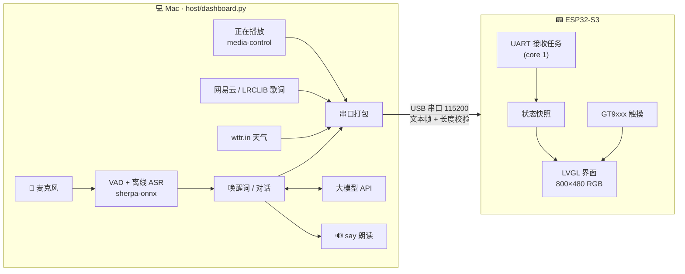

# 🐱 小耄 · ESP32-S3 桌面黑胶仪表盘 + AI 猫猫助手

> 一块 4.3 寸触摸屏，常驻桌面：黑胶唱片转着你正在听的网易云，歌词逐行滚动，旁边是时间、天气，
> 还有一只叫「小耄」的猫猫 AI，喊一声 **「你好耄耋」** 就会醒来陪你聊天。

<!-- 在这里放实物照片 / 演示 GIF，例如：
<p align="center"></p>
-->

---

## ✨ 功能

### 🧊 冰块磨砂风卡片仪表盘
- 800×480 全屏 LVGL 9 界面，深色冰川渐变背景 + 半透明磨砂玻璃卡片
- 主页四张卡片：**音乐 / 时间 / 天气 / 小耄**，点任意卡片进入全屏详情页，点屏幕任意位置返回
- 中文字体内嵌 TTF（TinyTTF 运行时渲染，16 ~ 120px 多档字号）

### 💿 黑胶播放器
- 专辑封面嵌在黑胶唱片中心，播放时整张唱片旋转，暂停即停
- 唱臂造型 + 播放进度条 + 当前/总时长
- 根据封面平均色给音乐卡片染色（暖色封面 → 暖色卡片）
- 同步歌词：主页显示上一句 / 当前句 / 下一句，详情页显示 5 行
- 自动过滤「作词 / 作曲 / 编曲…」这类署名行

### 🎵 网易云音乐
- Mac 上读取系统「正在播放」信息（任何播放器都行，主要配合网易云音乐）
- 歌词优先从网易云接口按歌名 + 歌手 + 时长匹配，失败时回退到 [LRCLIB](https://lrclib.net)

### 🌤 时间 & 天气
- 时间由电脑同步（含时区），断开后板子自己继续走
- 天气来自 [wttr.in](https://wttr.in)，默认城市深圳：当前温度、天气、体感、湿度、风速、今日温差和未来三天预报，每 15 分钟刷新

### 🐾 小耄 AI 助手
设计上参考了 [小智 xiaozhi-esp32](https://github.com/78/xiaozhi-esp32) 的交互方式：

- **语音唤醒**：说「你好耄耋」唤醒（拼音模糊匹配，"你好猫爹 / 你好毛蝶" 也能识别），也可以一口气说「你好耄耋，今天天气怎么样」
- **连续对话**：回答完后继续听 8 秒，接着说就行，不用重复唤醒词
- **打断**：小耄说话时再喊一声「你好耄耋」，立刻闭嘴开始听你说
- **情绪波形线**：屏幕上一条会呼吸的光线表示小耄的状态
  - 待机：缓慢呼吸 · 聆听：跟随你的音量起伏 · 思考：快速涟漪 · 说话：活泼跳动
  - AI 每次回复带一个情绪标签（开心 / 难过 / 生气 / 惊讶 / 平静 / 调皮），线条颜色和节奏随之变化
- 人设：一只爱哈气的圆头橘猫，口语化、简短、不超过 60 字
- 离线语音识别（sherpa-onnx Paraformer 中文模型 + Silero VAD），大模型支持 **OpenAI 兼容接口** 或 **Anthropic 接口**，语音播放用 macOS 自带 `say`

---

## 🔧 硬件

| 部件 | 型号 |
| --- | --- |
| 主控板 | 正点原子 **DNESP32S3**（ESP32-S3，N16R8：16MB Flash + 8MB PSRAM） |
| 屏幕 | 正点原子 4.3 寸 RGB 屏 **800×480**（ATK-MD0430R），16 位 RGB565 并口 |
| 触摸 | GT9xxx 电容触摸（I2C） |
| 连接 | USB 转串口（UART0，IO43/IO44），供电 + 数据一根线 |

### 引脚占用

| 功能 | GPIO |
| --- | --- |
| RGB 数据线 | B3-B7: 17 16 15 7 6 · G2-G7: 10 9 46 3 8 18 · R3-R7: 45 48 47 21 14 |
| RGB 控制 | DE = IO4，PCLK = IO5（无 HSYNC/VSYNC），背光走 XL9555 P13 |
| I2C（触摸 / XL9555 等） | SDA = IO41，SCL = IO42，触摸 INT = IO40 |
| 串口（和电脑通信） | IO43 / IO44 |
| USB | IO19 / IO20 |

**还空着的 IO**（想给小耄加麦克风、喇叭、灯之类的可以用）：IO1、IO2（仅输入）、IO11 / IO12 / IO13、IO38 / IO39。
板载 ES8388 音频因为引脚和 RGB 屏冲突用不了。详细的扩展建议见 [空闲 IO 规划](https://claude.ai/artifact/GEueeNcgkrHsLVbiNCW287)。

---

## 🏗 架构

ESP32 只负责显示和触摸，所有"重活"（音乐信息、歌词、天气、语音识别、大模型）都在 Mac 上的一个 Python 脚本里完成，再通过 USB 串口推送给板子。



### 串口协议

每帧是一行 UTF-8 文本，字段之间用 Tab 分隔，结尾带 `\t#<payload 字节数>` 做长度校验，长度对不上的帧直接丢弃（防止串口丢字节导致乱码）：

```
<类型>\t<字段1>\t<字段2>...\t#<前面内容的字节数>\n
```

| 类型 | 字段 | 说明 |
| --- | --- | --- |
| `M` | 歌名 歌手 专辑 播放中(0/1) 进度秒 总时长秒 | 正在播放 |
| `Y` | 上上句 上一句 当前句 下一句 下下句 | 歌词窗口 |
| `A` | base64(96×96 RGB565 小端) | 专辑封面 |
| `C` | Unix 时间戳 时区偏移秒 | 时间同步 |
| `W` | 温度 天气 城市 体感 湿度 风速 温差 预报1 预报2 预报3 | 天气 |
| `R` | 状态(idle/listen/think/speak) 用户的话 回复 情绪 | 小耄状态 |
| `V` | 音量 0-100 | 约 10Hz，驱动波形线 |

脚本每 10 秒会整体重发一次，板子重启后很快就能恢复显示。

---

## 🚀 编译烧录

### 环境
- [PlatformIO](https://platformio.org/)（VS Code 插件或命令行都行），框架为 ESP-IDF，依赖 LVGL 9.2.2（首次编译自动下载）
- Mac 端：[uv](https://docs.astral.sh/uv/)（自动装好 Python 依赖）、[media-control](https://github.com/ungive/media-control)（`brew install media-control`）

### 烧录固件

```bash
cd dashboard
# 把 platformio.ini 里的 upload_port / monitor_port 改成你自己的串口，
# 用 `ls /dev/cu.usbserial-*` 查看
pio run -t upload      # 编译 + 烧录，波特率 115200
pio device monitor     # 可选：看串口日志
```

### 运行 Mac 端脚本

```bash
uv run dashboard/host/dashboard.py
```

第一次运行会自动下载语音模型（约几十 MB）到 `~/.cache/maodie/`。
macOS 会请求 **麦克风** 权限，请允许给终端（或 uv）。

> ⚠️ 串口同一时间只能被一个程序占用：烧录前先停掉脚本（见下面的 `launchctl unload`），烧完再启动。

---

## ⚙️ 配置

在家目录创建 `~/.maodie.env`（**不要提交到 Git**），所有项都是可选的：

```ini
# 串口，不填则自动找 /dev/cu.usbserial-*
SERIAL_PORT=/dev/cu.usbserial-XXXXXX

# 天气
CITY=Shenzhen
CITY_NAME=深圳

# 大模型：openai（任何 OpenAI 兼容接口）或 anthropic
LLM_PROVIDER=openai
LLM_API_KEY=your-api-key-here
LLM_BASE_URL=https://api.example.com/v1
LLM_MODEL=your-model-name

# 语音
TTS_VOICE=Tingting        # macOS `say -v '?'` 可查看可用音色
MIC_DEVICE=               # 留空用默认麦克风

# 自定义人设（可选）
# BOT_PROMPT=你是……
```

没填 `LLM_API_KEY` 时，其他功能照常工作，小耄会提示你去配置。

---

## 🔁 开机自启（macOS launchd）

`dashboard/host/com.maodie.dashboard.plist` 是一个 LaunchAgent，登录后自动运行脚本、崩溃自动重启，日志写到 `~/Library/Logs/maodie.log`。

1. 打开 plist，把里面的 `/Users/kc/...` 改成你自己的用户名和路径（`uv` 的位置可用 `which uv` 查）
2. 安装并启动：

```bash
cp dashboard/host/com.maodie.dashboard.plist ~/Library/LaunchAgents/
launchctl load ~/Library/LaunchAgents/com.maodie.dashboard.plist
```

常用命令：

```bash
launchctl unload ~/Library/LaunchAgents/com.maodie.dashboard.plist   # 停止（烧录前）
launchctl load   ~/Library/LaunchAgents/com.maodie.dashboard.plist   # 启动
tail -f ~/Library/Logs/maodie.log                                    # 看日志
```

脚本自带单实例锁，手动再跑一个会自动退出，不会抢串口。

---

## 📁 目录结构

```
esp32/
├── dashboard/                     # ⭐ 主项目：仪表盘固件 + Mac 端
│   ├── main/
│   │   ├── main.c                 # 入口：初始化屏幕、触摸、串口，启动 LVGL 任务
│   │   ├── board.c / board.h      # RGB 屏时序、GT9xxx 触摸驱动
│   │   ├── link.c / link.h        # 串口接收、帧校验、协议解析
│   │   ├── ui.c / ui.h            # 全部界面：磨砂卡片、黑胶、歌词、天气、波形线
│   │   └── font.ttf               # 内嵌中文字体（子集）
│   ├── host/
│   │   ├── dashboard.py           # Mac 端：音乐/歌词/天气/语音助手 → 串口
│   │   └── com.maodie.dashboard.plist  # launchd 开机自启
│   ├── tools/
│   │   ├── mkfont.py              # 从系统字体裁出 GB2312 常用字子集
│   │   └── otf2ttf.py             # OTF(CFF) 转 TTF，供 TinyTTF 使用
│   ├── platformio.ini
│   ├── partitions-16MiB.csv
│   └── sdkconfig.atk
└── rgb/                           # 🐱 小实验：屏幕上循环播放耄耋哈气动画
    ├── main/main.c                # 把 240×240 帧放大 2 倍逐帧刷屏
    ├── components/BSP/RGBLCD/     # 正点原子 RGB 屏驱动
    └── tools/mkvideo.py, mkimg.py # 把 GIF 转成 RGB565 帧数据 / 生成背景图
```

---

## 🙏 致谢

- [xiaozhi-esp32](https://github.com/78/xiaozhi-esp32) —— 唤醒、连续对话、打断的交互设计参考
- [LVGL](https://lvgl.io/) —— 界面库
- [sherpa-onnx](https://github.com/k2-fsa/sherpa-onnx) —— 离线语音识别与 VAD
- [正点原子](http://www.openedv.com/) —— DNESP32S3 开发板与 RGB 屏例程
- [wttr.in](https://wttr.in)、[LRCLIB](https://lrclib.net)、网易云音乐 —— 天气与歌词数据
- 耄耋 —— 精神支柱 🐱

## 📄 License

<!-- 选一个协议，例如 MIT，并在仓库根目录放 LICENSE 文件 -->
