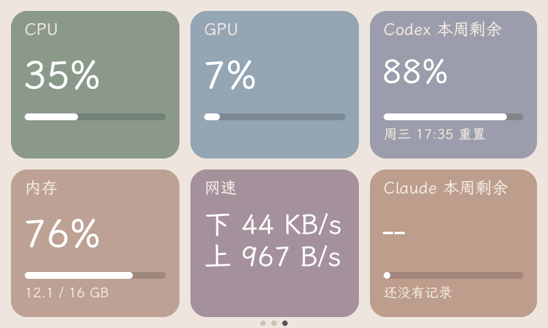
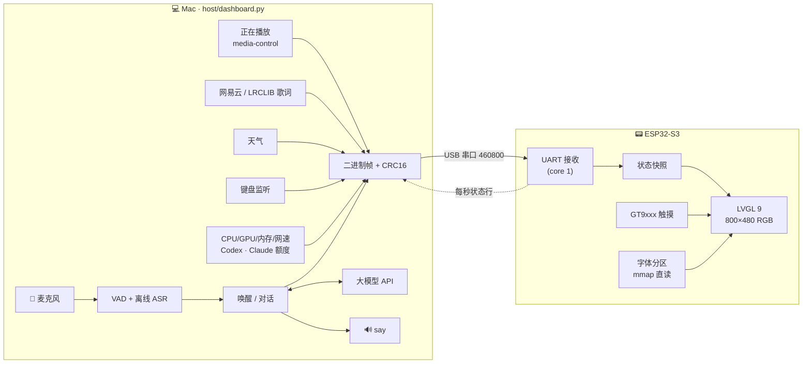
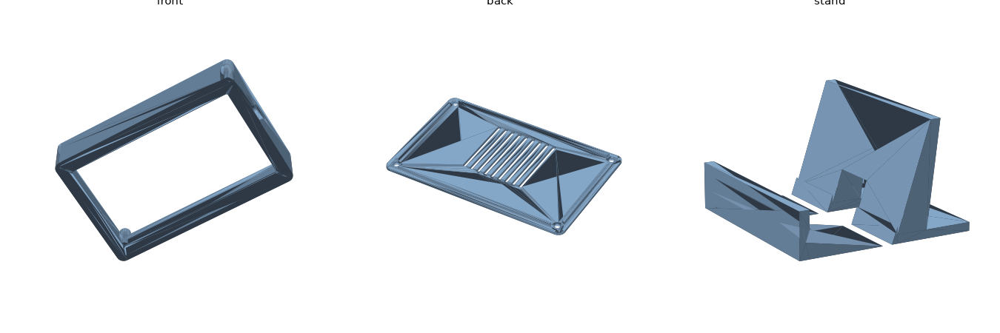

# 🐱 小耄 · ESP32-S3 桌面黑胶仪表盘 + AI 猫猫助手

> 一块 4.3 寸触摸屏，常驻桌面：黑胶唱片显示你正在听的网易云，歌词按进度滚动，旁边是时间、天气，
> 还有一只叫「小耄」的猫猫 AI，喊一声 **「你好耄耋」** 就会醒来陪你聊天。
> 左右滑动还能看键盘统计和电脑性能、Codex / Claude 本周剩余额度。

<!-- 在这里放实物照片 / 演示 GIF，例如：
<p align="center"></p>
-->

<p align="center"><br><sub>第三屏：系统监控（板子上实际画面，从帧缓冲读回）</sub></p>

---

## ✨ 功能

首页 → 键盘屏 → 系统屏，左右滑动循环切换；首页点任意卡片进全屏，点任意处返回。界面是莫兰迪纯色卡片 + 霞鹜文楷。

### 💿 黑胶 & 网易云
- 网易云（或任何播放器）正在播放的专辑封面合成在黑胶唱片中心，旁边是歌名 / 歌手 / 专辑和进度条
- 三行同步歌词（全屏页五行），优先从网易云按歌名 + 歌手 + 时长匹配，失败回退到 [LRCLIB](https://lrclib.net)；自动去掉「作词 / 作曲…」这类署名行
- 封面 240×240，分块发送并整图校验，收齐才换图，不会出现半张图

### 🕐 时间 & 🌤 天气
- 时间由电脑对时（含时区），断开后板子自己走
- 天气默认深圳：当前温度、天气、体感、湿度、风速、今日温差和三天预报。数据来自 [wttr.in](https://wttr.in)，取不到时自动换 [Open-Meteo](https://open-meteo.com)（用 `LAT` / `LON` 坐标）

### 🐾 小耄 AI 助手
交互参考了 [小智 xiaozhi-esp32](https://github.com/78/xiaozhi-esp32)：

- **语音唤醒**：说「你好耄耋」（拼音模糊匹配），也可以一句话说完「你好耄耋，今天天气怎么样」
- **连续对话**：回答完继续听几秒，接着说就行，不用重复唤醒
- **打断**：小耄说话时再喊一声「你好耄耋」，立刻停下听你说
- **情绪波形线**：一根随状态和情绪起伏的线。待机呼吸、聆听跟随音量、思考快速涟漪、说话活泼跳动；AI 回复带情绪标签（开心 / 难过 / 生气 / 惊讶 / 平静 / 调皮），线的颜色和节奏随之变化
- 离线语音识别（sherpa-onnx Paraformer 中文 + Silero VAD），大模型支持 **Anthropic** 或任意 **OpenAI 兼容接口**，朗读用 macOS 自带 `say`

### ⌨️ 键盘屏
- 大字显示刚按下的键（含 ⌘⌥⇧⌃ 组合键）和键值、最近输入、今天按了多少次、每分钟按键数

### 📊 系统屏
- CPU、GPU、内存、上下行网速
- **Codex 本周剩余额度** + 5 小时额度：读取 Codex CLI 本地会话日志里的 rate limit
- **Claude 本周剩余额度** + 5 小时额度：通过 Claude Code 状态栏脚本 `host/claude_statusline.py` 获取（配置见下文）

---

## 🔧 硬件

| 部件 | 型号 |
| --- | --- |
| 主控板 | 正点原子 **DNESP32S3**（ESP32-S3，N16R8：16MB Flash + 8MB PSRAM） |
| 屏幕 | 正点原子 4.3 寸 RGB 屏 **800×480**（ATK-MD0430R），16 位 RGB565 并口 |
| 触摸 | GT9xxx 电容触摸（I2C） |
| 连接 | 板载 USB 转串口（CH340，UART0），供电 + 数据一根线 |
| 外壳（可选） | 3D 打印，见 [`case/`](case/) |

### 引脚占用

| 功能 | GPIO |
| --- | --- |
| RGB 数据线 | B3-B7: 17 16 15 7 6 · G2-G7: 10 9 46 3 8 18 · R3-R7: 45 48 47 21 14 |
| RGB 控制 | DE = IO4，PCLK = IO5（无 HSYNC/VSYNC），背光走 XL9555 P13 |
| I2C（触摸 / XL9555 等） | SDA = IO41，SCL = IO42，触摸 INT = IO40 |
| 串口（和电脑通信） | IO43 / IO44 |
| USB | IO19 / IO20 |

**空闲 IO**（以后想给板子直接接麦克风、喇叭、灯）：IO1、IO2（仅输入）、IO11 / IO12 / IO13、IO38 / IO39。板载 ES8388 音频和 RGB 屏引脚冲突，用不了。

---

## 🏗 架构

ESP32 只负责显示和触摸，所有重活（音乐、歌词、天气、语音识别、大模型、系统数据）都在 Mac 上的一个 Python 脚本里做，再通过 USB 串口推给板子。



**稳定性设计**（第一版反复花屏后重构得出的规则，长测 3.7 万帧零坏帧）：

- 串口：二进制帧 + CRC16，坏帧整帧丢，字段永远不会串位；电脑端每 3 秒全量重发，板子重启后自动补齐
- 渲染：没有滚动字幕、没有旋转、没有半透明和渐变；每个文字框尺寸固定，放不下就换小字号或换行
- 黑胶和封面合成一张不透明图，只在换封面时重画
- LVGL 堆放在 PSRAM，内部 RAM 留给串口驱动、渲染缓冲和屏幕 bounce buffer
- 字体放在独立 flash 分区，通过 cache 映射直接读，不拷进内存

完整协议见 [PROTOCOL.md](PROTOCOL.md)。整个开发过程和踩坑记录见 [Vibe Coding 复盘](docs/vibe-coding-guide/README.md)。

---

## 🚀 上手

### 1. 环境
- [PlatformIO](https://platformio.org/)（ESP-IDF 框架，LVGL 9.2.2 首次编译自动下载）
- Mac 端：[uv](https://docs.astral.sh/uv/)（自动装 Python 依赖）、[media-control](https://github.com/ungive/media-control)（`brew install media-control`）

### 2. 准备字体（只需一次）
仓库不带字体文件，按 [firmware/font/README.md](firmware/font/README.md) 用开源的霞鹜文楷生成并烧进字体分区。

### 3. 烧录固件

```bash
cd firmware
# 先把 platformio.ini 里的 upload_port / monitor_port 改成你的串口（ls /dev/cu.usbserial-*）
pio run -t upload
```

> ⚠️ 串口同一时间只能被一个程序占用：烧录前先停掉电脑端脚本，烧完再启动。

### 4. 配置

```bash
cp host/maodie.env.example ~/.maodie.env    # 然后编辑，这个文件不要提交
```

```ini
LLM_PROVIDER=anthropic        # 或 openai（任何 OpenAI 兼容接口）
LLM_BASE_URL=                 # 留空用官方地址
LLM_API_KEY=your-api-key-here
LLM_MODEL=your-model-name
MIC_DEVICE=                   # 留空用默认麦克风
TTS_VOICE=Tingting            # say -v '?' 查看可用音色
CITY=Shenzhen
CITY_NAME=深圳
# LAT=22.54  LON=114.06               # 备用天气源用的坐标，各占一行
# SERIAL_PORT=/dev/cu.usbserial-XXXX   # 不填自动找
# BOT_PROMPT=你是……                    # 自定义人设
```

没填 `LLM_API_KEY` 时其他功能照常，小耄会提示你去配置。

### 5. 运行电脑端

```bash
uv run host/dashboard.py
```

- 第一次运行会下载语音模型到 `~/.cache/maodie/`
- macOS 权限：**麦克风**（小耄），**辅助功能 + 输入监控**（键盘屏）。用 uv 运行时要授权给实际的 Python 解释器（`~/.local/share/uv/python/.../bin/python3.x`），不是终端
- 环境变量：`MAODIE_DEBUG=1` 打印板子每秒的状态行，`MAODIE_NO_BOT=1` 不启动语音

### 6. Claude 额度（可选）

系统屏的「Claude 本周剩余」需要让 Claude Code 把额度写到本地。在 `~/.claude/settings.json` 里加：

```json
{
  "statusLine": {
    "type": "command",
    "command": "python3 /path/to/maodie-dashboard/host/claude_statusline.py"
  }
}
```

它从 Claude Code 传入的会话信息里读出额度，存到 `~/.cache/maodie/claude_usage.json`，同时在状态栏显示「模型名 本周已用 xx%」。不读取也不保存任何密钥。用过一次 Claude Code 后屏上才会有数字。

Codex 额度不用配置，脚本会读 `~/.codex/sessions/` 里最新的日志；没用过 Codex 时显示「还没有记录」。

---

## 🔁 开机自启（macOS launchd）

1. 打开 `host/com.maodie.dashboard.plist`，把 `YOUR_NAME` 和路径改成你自己的（`which uv` 查 uv 的位置）
2. 安装：

```bash
cp host/com.maodie.dashboard.plist ~/Library/LaunchAgents/
launchctl bootstrap gui/$(id -u) ~/Library/LaunchAgents/com.maodie.dashboard.plist
```

```bash
launchctl bootout gui/$(id -u)/com.maodie.dashboard     # 停止（烧录前）
tail -f ~/Library/Logs/maodie.log                         # 看日志
```

脚本自带单实例锁，手动再跑一个会自动退出，不会抢串口。

### 调试截图
脚本运行时执行 `touch ~/.cache/maodie/snap.req`，它会从板子逐块读回帧缓冲（带 CRC），存成 `~/.cache/maodie/snap.png`，就是屏上实际显示的画面。

---

## 🧱 3D 打印外壳

`case/case.py` 是参数化外壳（前壳 + 后盖 + 15° 支架），用 manifold3d 生成：

```bash
cd case && uv run python case.py     # → out/front.stl, back.stl, stand.stl
```

<p align="center"></p>

> ⚠️ 草稿：脚本里标了「估」的尺寸（屏幕模块外形、总厚度、USB 开口位置等）还没用实物量过，打印前请用卡尺核对并改参数。

---

## 📁 目录结构

```
maodie-dashboard/
├── firmware/                   # ESP32-S3 固件（PlatformIO + ESP-IDF + LVGL 9）
│   ├── main/
│   │   ├── main.c              # 入口：映射字体分区，初始化屏幕、触摸、串口、LVGL
│   │   ├── board.c / .h        # RGB 屏时序、GT9xxx 触摸
│   │   ├── link.c / .h         # 串口帧解析、CRC、封面分块重组、状态回报
│   │   ├── ui.c / .h           # 首页、键盘屏、系统屏、全屏页、波形线
│   │   └── lv_mem_psram.c      # LVGL 堆放到 PSRAM
│   ├── font/README.md          # 字体生成与烧录说明（字体文件不入库）
│   ├── tools/                  # mkfont2.py 裁子集、mkfontbin.py 打包分区、otf2ttf.py
│   ├── partitions.csv          # app 4MB + 字体分区 8MB @0x400000
│   └── platformio.ini
├── host/
│   ├── dashboard.py            # Mac 端：音乐/歌词/天气/键盘/系统/小耄 → 串口
│   ├── claude_statusline.py    # Claude Code 状态栏脚本，记录额度
│   ├── maodie.env.example      # 配置模板
│   └── com.maodie.dashboard.plist
├── case/                       # 3D 打印外壳（参数化草稿）
├── docs/
│   ├── vibe-coding-guide/      # 和 AI 结对开发的全过程复盘 + 可复用 SKILL.md
│   └── images/
├── PROTOCOL.md                 # 串口协议
└── README.md
```

---

## 🙏 致谢

- [xiaozhi-esp32](https://github.com/78/xiaozhi-esp32)：唤醒、连续对话、打断的交互设计参考
- [LVGL](https://lvgl.io/)：界面库
- [sherpa-onnx](https://github.com/k2-fsa/sherpa-onnx)：离线语音识别与 VAD
- [霞鹜文楷 LXGW WenKai](https://github.com/lxgw/LxgwWenKai)：开源字体
- [正点原子](http://www.openedv.com/)：DNESP32S3 开发板与 RGB 屏例程
- [LRCLIB](https://lrclib.net)、网易云音乐：歌词数据
- 耄耋：精神支柱 🐱

## 📄 License

[MIT](LICENSE) © 2026 Ivy Du

字体（霞鹜文楷，SIL OFL）和第三方库（LVGL、sherpa-onnx 等）遵循各自的协议。
